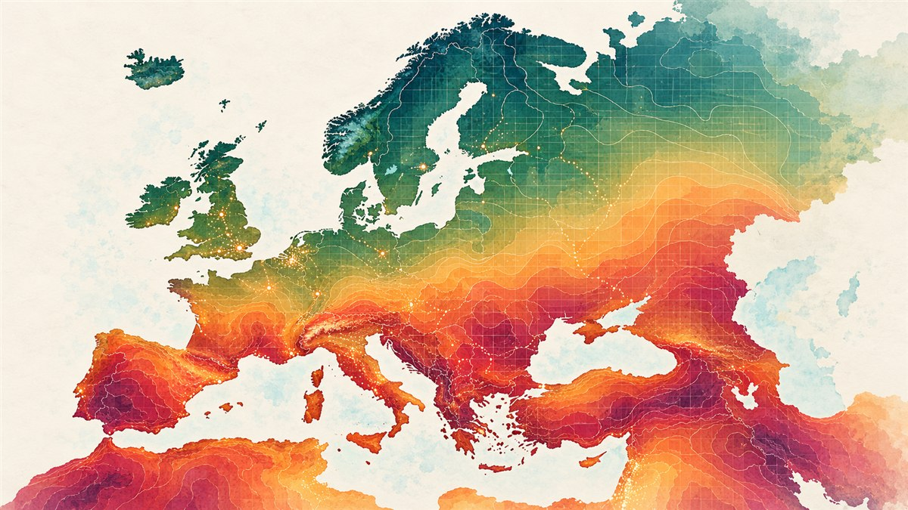
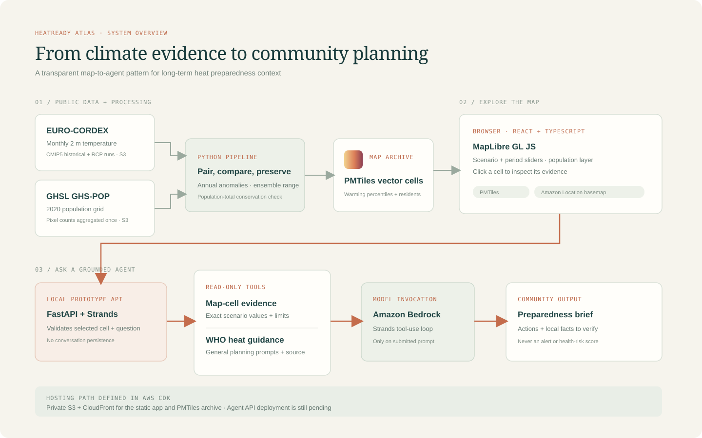

# HeatReady Atlas — Europe



HeatReady Atlas pairs a map of long-term European warming scenarios with a Strands climate-resilience agent. Select a climate-grid cell and the agent turns its model range and 2020 population context into a concise community heat-preparedness planning brief.

The app supports community planning. It is not a heat-warning service, a weather forecast, or a health-risk assessment.

## What people can explore

- Compare EURO-CORDEX CMIP5 RCP 4.5 and RCP 8.5 annual-mean temperature changes for 2041–2060 and 2081–2100.
- Toggle the GHSL 2020 population layer and inspect warming percentiles and the population estimate for a clicked climate cell.
- Ask the Strands agent for a short planning brief grounded in the selected cell and general WHO/Europe heat guidance. The agent also identifies local facts the community should verify, such as venue access and capacity.

The agent does not estimate vulnerable residents or health outcomes, issue live alerts, or claim that cooling centers or services exist at a location. It directs users to local authorities for current warnings and services. No community benefit has been measured yet. A pilot could track whether participating groups verify a local warning source and an accessible cool-space option, then assign an owner and review date to outreach actions. The prototype does not track users or store personal data.

## Data and method

- **EURO-CORDEX CMIP5:** monthly 2 m air temperature (`tas`) for historical, RCP 4.5, and RCP 8.5 runs. The pipeline pairs future runs with their historical counterpart, computes annual-mean changes against 1981–2000 for 2041–2060 and 2081–2100, then summarizes the matched models with the median and 10th–90th percentiles.
- The current ensemble uses three complete EUR-11 pairs on the CLMcom CCLM4-8-17 grid: CNRM-CERFACS-CNRM-CM5, ICHEC-EC-EARTH, and MPI-M-MPI-ESM-LR. The MOHC-HadGEM2-ES archive ends during 2099, so it is omitted to keep the ensemble consistent across periods. Native model calendars, including 360-day calendars, are respected.
- **GHSL GHS-POP:** 2020 residential population grid. Pixel-center assignment allocates each pixel count once to a climate cell; the pipeline checks that the aggregated total is preserved within the climate-grid footprint.
- The present local archive contains 174,688 climate cells and 1,014,002,935 residents within that footprint. Population is shown at climate-grid scale, not as a precise neighborhood count.

Sources: [EURO-CORDEX on the Registry of Open Data on AWS](https://registry.opendata.aws/euro-cordex/) and [GHSL population on the Registry of Open Data on AWS](https://registry.opendata.aws/ghs-pop/). GHSL attribution: European Commission Joint Research Centre. Check each source dataset's current terms before redistributing derived data.

## Agent design

The Python API uses the **Strands Agents SDK** with Amazon Bedrock. For each request, the browser sends only the selected cell's ID, scenario, period, warming percentiles, population estimate, and the user's question. The API validates the values, then creates a Strands agent with two read-only tools:

1. `read_selected_map_cell` returns the exact validated map values, source labels, and interpretation limits.
2. `get_community_heat_actions` returns a small set of general planning prompts grounded in [WHO/Europe heat guidance](https://www.who.int/europe/news-room/fact-sheets/item/keepcool-in-the-heat).

The model synthesizes those tool results into a short brief and a local verification task. Requests are not persisted by this prototype. Do not enter personal or medical details. Bedrock inference happens only after a user submits a question and may incur AWS charges.

## Architecture



See [docs/ARCHITECTURE.md](docs/ARCHITECTURE.md) for the component flow and hosting details.

## Run locally

Requirements: Python 3.10+, Node.js 20+, and AWS credentials permitted to invoke the selected Bedrock model. Bedrock model access must be enabled in the chosen region.

1. Copy `web/.env.example` to `web/.env.local`. Set `VITE_LOCATION_API_KEY` to the referrer-restricted, map-only Amazon Location key. The key is browser-visible; never use AWS secret access keys in this file.
2. Place `data/climate-cells.pmtiles` at `web/public/climate-cells.pmtiles` (create `web/public` if needed). The source archive and generated files are excluded from Git.
3. In `agent/`, copy `.env.example` to `.env` and adjust the profile or region if needed. Start the agent API in one PowerShell window:

   ```powershell
   cd agent
   python -m venv .venv
   .\.venv\Scripts\Activate.ps1
   pip install -r requirements.txt
   uvicorn main:app --reload --host 127.0.0.1 --port 8000
   ```

4. In another PowerShell window, run the web app:

   ```powershell
   cd web
   npm install
   npm run dev
   ```

5. Open the Vite URL, select a populated map cell, and submit a question in the community planning panel. A Bedrock request starts only when you submit.

Set `VITE_AGENT_API_URL` in `web/.env.local` when the API is hosted somewhere other than `http://127.0.0.1:8000`. Use HTTPS and restrict allowed browser origins before public hosting.

## Build the data archive

See [pipeline/README.md](pipeline/README.md) for source selection, manifest, and build instructions. The reproducible pipeline emits local data files; it does not upload them.

## AWS services and publication status

- **Amazon Location Service** supplies the MapLibre basemap with a map-only API key restricted to allowed referrers.
- **Amazon S3 and CloudFront** host the static app and PMTiles archive; the live API is routed through the same CloudFront domain.
- **AWS Lambda and Amazon Bedrock** run the Strands agent when a visitor submits a brief request. Lambda uses an execution role scoped to the EU Nova Lite inference profile and its destination model ARNs.
- The live app is [HeatReady Atlas](https://d1p7fe2ijqxr2z.cloudfront.net). The API health endpoint is available at `/api/health`. The source climate archive remains local and ignored by Git; the derived PMTiles archive is hosted in S3.

The deployed API uses same-origin CloudFront routing and a Lambda execution role with least-privilege Bedrock permissions. For a different hosting setup, provide an HTTPS API endpoint and configure the browser origin and `VITE_AGENT_API_URL` accordingly.

The map CDK stack defaults to `eu-central-1`. For changes, review `npx cdk diff`, account, region, permissions, and costs before deployment. Do not commit `.env.local`, credentials, climate files, or generated rasters.

## Interpretation limits

- RCP 4.5 and RCP 8.5 are conditional scenario pathways, not probability-ranked forecasts.
- The ensemble range represents spread among three selected model pairs; it is not a confidence interval.
- Annual means do not represent heatwaves, daily extremes, urban heat islands, health impacts, or future population.
- Population counts are aggregated to the climate grid and should not be read as precise local counts or vulnerable-person counts.
- The agent drafts planning prompts from this limited context and cited general guidance; local authorities must verify warnings, services, access, and capacity.

## Demo and project submission

Follow [docs/DEMO.md](docs/DEMO.md) to record a public demo under three minutes. The script is prepared; no video has been recorded or uploaded yet. The Builder Center article draft is in [docs/BUILDER_PROJECT_DRAFT.md](docs/BUILDER_PROJECT_DRAFT.md).
