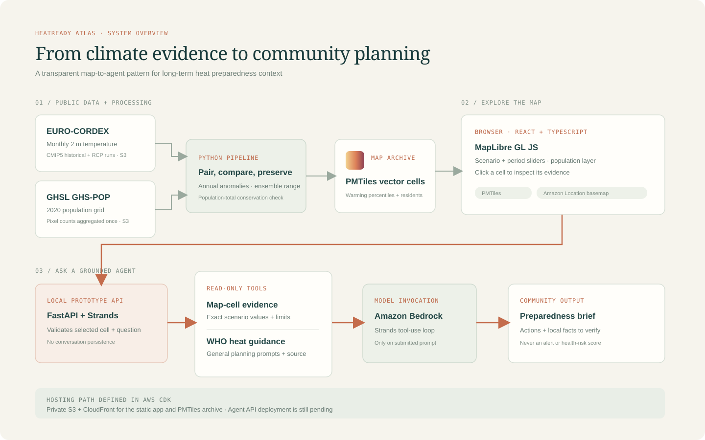

# High-level architecture

## Data flow

1. Read public monthly `tas` runs from the EURO-CORDEX archive in Amazon S3 and 2020 population counts from the GHSL raster in Amazon S3.
2. A Python pipeline matches three EUR-11 model pairs with complete coverage through 2100, computes annual temperature changes for the two future periods, and summarizes the model spread.
3. The pipeline allocates GHSL pixel counts once to the climate cell containing each pixel center, checks conservation within the model footprint, and encodes 174,688 cells as a 4,303-tile PMTiles vector archive.
4. The React and MapLibre app uses the PMTiles protocol for cell data. Amazon Location Service supplies the basemap through a map-only API key with a referrer restriction.
5. The CDK stack provisions the private S3 origin, CloudFront distribution, Amazon Location map, and referrer-restricted map key.

## Current state

The local map, archive, and map controls are running and have been validated. The static hosting infrastructure is deployed, but the final app build and generated PMTiles archive have not been uploaded to the CloudFront origin. There is not yet a public map endpoint.

## Scale and limitations

- The archive covers 174,688 EUR-11 cells at zoom levels 4–8.
- The current ensemble has three complete driving-model pairs: CNRM-CERFACS-CNRM-CM5, ICHEC-EC-EARTH, and MPI-M-MPI-ESM-LR.
- The map shows scenario-conditioned annual means and 2020 population context. It does not estimate daily extremes, future population, personal exposure, or health outcomes.
